<!-- The cards are generated by scripts/render_cards.py; see .github/workflows/cards.yml. -->
<picture><source media="(prefers-color-scheme: dark)" srcset="cards/hero-dark.svg"></picture>

<a href="https://lloyd-portfolio-sand.vercel.app"><picture><source media="(prefers-color-scheme: dark)" srcset="cards/tile-portfolio-dark.svg"></picture></a>
<a href="https://www.linkedin.com/in/lloyddso"><picture><source media="(prefers-color-scheme: dark)" srcset="cards/tile-linkedin-dark.svg"></picture></a>
<a href="mailto:lloyd25dsouza@gmail.com"><picture><source media="(prefers-color-scheme: dark)" srcset="cards/tile-email-dark.svg"></picture></a>

<picture><source media="(prefers-color-scheme: dark)" srcset="cards/activity-dark.svg"></picture>

<a href="https://github.com/lloydaq/TND-The-News-Detector"><picture><source media="(prefers-color-scheme: dark)" srcset="cards/repo-tnd-the-news-detector-dark.svg"></picture></a>

<a href="https://github.com/lloydaq/DataSentry"><picture><source media="(prefers-color-scheme: dark)" srcset="cards/repo-datasentry-dark.svg"></picture></a>

<a href="https://github.com/lloydaq/flowcast"><picture><source media="(prefers-color-scheme: dark)" srcset="cards/repo-flowcast-dark.svg"></picture></a>

<a href="https://github.com/lloydaq/CampusSignal-pro"><picture><source media="(prefers-color-scheme: dark)" srcset="cards/repo-campussignal-pro-dark.svg"></picture></a>

<picture><source media="(prefers-color-scheme: dark)" srcset="cards/graph-dark.svg"></picture>
