<!-- Every card is generated by scripts/render_cards.py and refreshed daily by .github/workflows/cards.yml. Edit the script, not the SVGs. -->
<a href="https://lloyd-portfolio-sand.vercel.app"><picture><source media="(prefers-color-scheme: dark)" srcset="cards/hero-dark.svg"></picture></a>

<a href="https://lloyd-portfolio-sand.vercel.app"><picture><source media="(prefers-color-scheme: dark)" srcset="cards/tile-portfolio-dark.svg"></picture></a>
<a href="https://www.linkedin.com/in/lloyddso"><picture><source media="(prefers-color-scheme: dark)" srcset="cards/tile-linkedin-dark.svg"></picture></a>
<a href="mailto:lloyd25dsouza@gmail.com"><picture><source media="(prefers-color-scheme: dark)" srcset="cards/tile-email-dark.svg"></picture></a>

<picture><source media="(prefers-color-scheme: dark)" srcset="cards/section-toolkit-dark.svg"></picture>
<picture><source media="(prefers-color-scheme: dark)" srcset="cards/toolkit-dark.svg"></picture>

<picture><source media="(prefers-color-scheme: dark)" srcset="cards/section-signal-dark.svg"></picture>
<picture><source media="(prefers-color-scheme: dark)" srcset="cards/activity-dark.svg"></picture>

<picture><source media="(prefers-color-scheme: dark)" srcset="cards/section-lately-dark.svg"></picture>
<picture><source media="(prefers-color-scheme: dark)" srcset="cards/lately-dark.svg"></picture>

<picture><source media="(prefers-color-scheme: dark)" srcset="cards/section-work-dark.svg"></picture>
<a href="https://github.com/lloydaq/TND-The-News-Detector"><picture><source media="(prefers-color-scheme: dark)" srcset="cards/repo-tnd-the-news-detector-dark.svg"></picture></a>
<a href="https://github.com/lloydaq/DataSentry"><picture><source media="(prefers-color-scheme: dark)" srcset="cards/repo-datasentry-dark.svg"></picture></a>
<a href="https://github.com/lloydaq/flowcast"><picture><source media="(prefers-color-scheme: dark)" srcset="cards/repo-flowcast-dark.svg"></picture></a>
<a href="https://github.com/lloydaq/CampusSignal-pro"><picture><source media="(prefers-color-scheme: dark)" srcset="cards/repo-campussignal-pro-dark.svg"></picture></a>

<b>More from the lab</b> &nbsp;·&nbsp; click to expand

 

| Project | What it is | Built with |
| :-- | :-- | :-- |
| [**inkshift**](https://github.com/lloydaq/inkshift) | Theme-switching library with organic ink-splat transitions and reversible animations for light, dark and system themes | TypeScript · React |
| [**CampusSignal**](https://github.com/lloydaq/CampusSignal) | Explainable campus incident intelligence: duplicate detection, prioritisation and evidence-backed resolution | Python |
| [**lloyd-portfolio**](https://github.com/lloydaq/lloyd-portfolio) | Personal portfolio showcasing AI/ML projects and engineering work | JavaScript |

<picture><source media="(prefers-color-scheme: dark)" srcset="cards/section-city-dark.svg"></picture>
<picture><source media="(prefers-color-scheme: dark)" srcset="cards/city-dark.svg"></picture>

<picture><source media="(prefers-color-scheme: dark)" srcset="cards/footer-dark.svg"></picture>

How this profile is built

 

No third-party widgets. Every card is a hand-built SVG rendered by <a href="scripts/render_cards.py"><code>scripts/render_cards.py</code></a> from live GitHub GraphQL data, with subset fonts embedded and pure CSS / SMIL animation, in a light and a dark variant. A <a href=".github/workflows/cards.yml">GitHub Action</a> re-renders everything daily. Motion respects <code>prefers-reduced-motion</code>.

